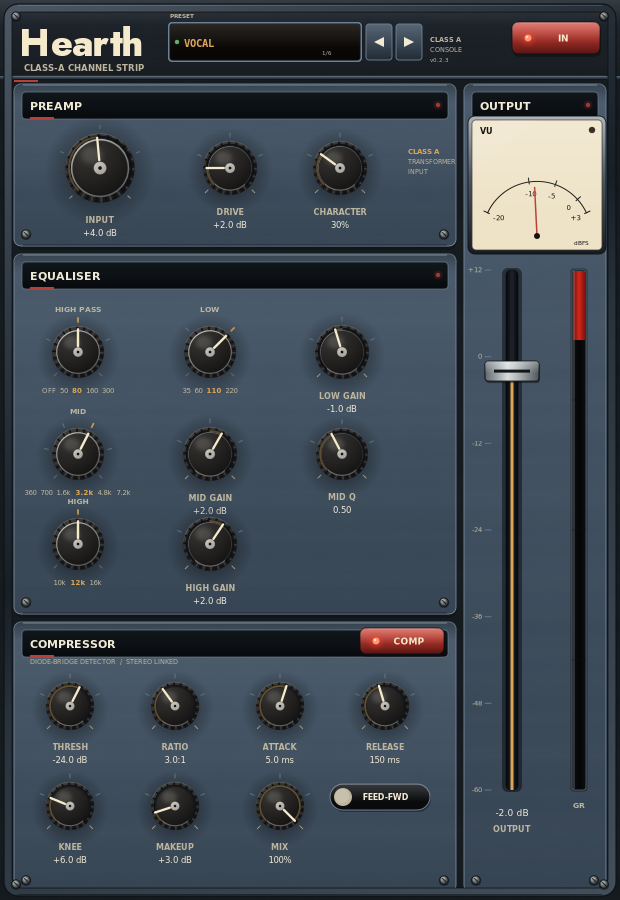

# Hearth Channel

[](https://github.com/tylorismusic-commits/hearth/actions/workflows/build.yml)

**Version 0.2.3** · [GitHub](https://github.com/tylorismusic-commits/hearth) · GPL-3.0-or-later

**Hearth Channel** is a free, open-source LV2 and CLAP channel strip for Linux, modelled
on the classic British Class-A consoles: a transformer-coupled input stage, a
three-band inductor-style EQ, a diode-bridge-flavoured compressor, and an output
fader.

It is a from-scratch implementation, not an emulation of any specific circuit,
and is not affiliated with or endorsed by AMS Neve or any other manufacturer.
The goal is the workflow and tonal family of a classic console strip — thick
Class-A saturation, broad musical EQ, and glue-y dynamics — in a small, hackable
codebase.



## Features

- **Stereo, zero-latency** — no oversampling, no latency reporting, no
  added delay in the host.
- **Class-A input stage** — input trim, drive, and character controls;
  asymmetric `tanh` saturation with first-order antiderivative anti-aliasing
  (ADAA), a transformer high-pass, and a touch of even-order harmonic content.
- **Three-band EQ** — 18 dB/oct high-pass (off / 50 / 80 / 160 / 300 Hz),
  low shelf (30–250 Hz, ±8 dB), mid bell (200 Hz–8 kHz, ±9 dB,
  Q 0.2–2, default 0.4), and high shelf (6–16 kHz, ±8 dB). Flat bands are
  mathematically transparent.
- **Stereo-linked compressor** — threshold, ratio, attack, release, knee,
  makeup, parallel mix, and a **feed-forward / feedback** topology switch.
  Peak detector with a fixed 120 Hz side-chain high-pass for a transformer-like
  low-end response. Soft knee, 20 ms–2 s release range.
- **Output fader** — −60 to +12 dB, plus gain-reduction and output-level meter
  ports.
- **Host gain-reduction metering** — the LV2 build publishes GR on its
  `gr_meter` port and draws it in Ardour's mixer through the Harrison
  inline-display extension. The CLAP build reports GR through
  `clap.gain-adjustment-metering`, so REAPER can draw it on the track meter.
- **Hidden output soft clipper** — a +0.2 dBFS ADAA `tanh` ceiling after the
  fader catches hot signals and adds odd-order console-style saturation
  instead of hard digital clipping. No control; bypass stays clean.
- **Master bypass** — click-free crossfade, ignores the fader when bypassed, and is separate from the host's own FX bypass.
- **Preset bar** — five musical starting points plus a deliberately broken
  preset, applied directly through the UI so they work in any host.
- **Custom X11/Cairo console-strip UI** — a vertical module layout with
  original Neve-style knob artwork (`assets/knob.png`, generated by
  `assets/make_knob.py`), rotary frequency switches, a VU meter,
  gain-reduction meter, and a long console fader. The UI is resizable and scales from its 620×900 logical layout, so it
  fits small laptop screens and HiDPI displays. Drag-to-edit knobs, double-click
  reset, scroll wheel, and shift-drag fine mode are supported.
- **Generic LV2 UI fallback** via complete port metadata, groups, units,
  scale points, and port designations.
- **Factory presets** for vocal, drum bus, bass DI, and mix bus.

## Signal flow

```
Input ──▶ Input trim ──▶ Class-A saturation ──▶ Transformer HP
      ──▶ 18 dB/oct HPF ──▶ Low shelf ──▶ Mid bell ──▶ High shelf
      ──▶ Compressor (feed-forward or feedback) ──▶ Output fader
      ──▶ Bypass crossfade ──▶ Output
```

The dry/parallel mix of the compressor is taken around the compressor only, so
the EQ and preamp always remain in the path.

## Build

Requirements:

- Linux, a C++17 compiler, CMake ≥ 3.16
- `lv2` development headers
- `cairo` and `x11` development headers (for the custom UI)
- `lilv` (tests only)
- `xvfb` (UI integration tests only)
- CLAP headers are vendored in `third_party/clap` (MIT), so no external CLAP
  SDK is required

```sh
cmake -S . -B build -DCMAKE_BUILD_TYPE=Release
cmake --build build -j
ctest --test-dir build --output-on-failure
```

The LV2 bundle is produced in `build/lv2/hearth.lv2/`. The CLAP build is
produced in `build/clap/Hearth.clap` with its `Hearth.resources` directory.

### Install for the current user

```sh
cmake -S . -B build -DCMAKE_BUILD_TYPE=Release \
  -DLV2_DIR="$HOME/.lv2" -DCLAP_DIR="$HOME/.clap"
cmake --build build -j
cmake --install build
```

### Install system-wide

```sh
cmake -S . -B build -DCMAKE_BUILD_TYPE=Release \
  -DLV2_DIR="/usr/lib/lv2" -DCLAP_DIR="/usr/lib/clap"
cmake --build build -j
sudo cmake --install build
```

The bundle contains:

- `hearth.so` — the LV2 DSP plugin
- `hearthUI.so` — the X11/Cairo UI (built when Cairo and X11 are available)
- `manifest.ttl`, `hearth.ttl`, `presets.ttl`
- `Hearth.clap` and `Hearth.resources/` — the CLAP build, which uses the same
  DSP and the same X11 UI

## Using it

After installing, rescan plugins in your host (or restart it) and look for
**Hearth Channel** under the effect/plugin list.

- **Ardour** — right-click a track's processor box, choose *New Plugin >
  By Creator > Hearth*, and open the plugin window. The custom UI is an X11
  window, so it also works under Wayland through XWayland. Ardour's generic
  controls are available if the custom UI cannot be embedded.
- **Carla** — add the plugin from the LV2 list and double-click it to open the
  UI.
- **REAPER** — open *Options > Preferences > Plug-ins > LV2* and click
  **Re-scan** after installing or updating. The plugin appears as
  **LV2: Hearth Channel**. In the FX window, use the **UI** button in the
  header to switch between the generic sliders and the native console strip;
  if the FX window is docked and clipped, float it or drag its corner (the UI
  scales with the window). If an older broken build is in the "plug-ins that
  failed to scan" list, re-scan the LV2 paths (or clear that entry) so REAPER
  retries it.
- **REAPER gain reduction** — install the CLAP build and use
  **CLAP: Hearth Channel (Tylor)**. Enable **Display gain reduction for
  plug-ins that support it** in *Preferences > Appearance > Track/Send
  Defaults* (for new tracks) or right-click the track meter and enable it for
  an existing track. REAPER then draws the GR bar on the track meter in the
  mixer. LV2 itself has no standard host-meter GR API, which is why the LV2
  build reports GR through its output port and the Ardour inline display
  instead.
- **Ardour gain reduction** — use the LV2 build; Ardour draws the live GR
  meter in the mixer strip through the inline-display extension.

The plugin is stereo. Mono tracks in most hosts are automatically fanned to
both inputs (or can be wired that way with the host's pin/connection editor),
so it works on vocals, bass, and other mono sources as well as buses.

Factory presets are exposed through the host's preset menu. The six bundled
presets include *Vocal - Air and Control*, *Drum Bus - Glue*, *Bass DI -
Weight*, *Mix Bus - British Glue*, *Acoustic - Natural*, and *Broken Console*.

## Presets

The preset bar in the UI header has:

- **Vocal - Air & Control** — controlled vocal chain with a wide mid lift
- **Drum Bus - Glue** — slow attack and a parallel drum-bus blend
- **Bass DI - Weight** — transformer weight and a broad low-mid lift
- **Mix Bus - British Glue** — subtle feedback compression and broad shaping
- **Acoustic - Natural** — open acoustic shaping
- **Broken Console** — maximum drive, extreme EQ, crushed feedback compression,
  output into the clipper

Use the `<` and `>` buttons next to the LCD, or click the LCD itself. Presets
write every control through the LV2 UI, so they apply even in hosts that ignore
`.ttl` presets; the same six are also provided as LV2 preset resources for hosts
that support them. An asterisk in the display means the preset has been edited.

## Controls

### Preamp

| Control | Range | Notes |
| --- | --- | --- |
| Input Gain | −20 … +30 dB | Trim into the saturation stage |
| Drive | 0 … 12 dB | How hard the Class-A stage is driven |
| Character | 0 … 100 % | Asymmetry / even-harmonic content |

### EQ

| Control | Range | Notes |
| --- | --- | --- |
| HPF | Off, 50, 80, 160, 300 Hz | 18 dB/oct, 3rd-order Butterworth |
| Low Freq | 30 … 250 Hz | Scale points at 35 / 60 / 110 / 220 Hz |
| Low Gain | ±8 dB | Low shelf |
| Mid Freq | 200 Hz … 8 kHz | Scale points at 360 / 700 / 1.6k / 3.2k / 4.8k / 7.2k |
| Mid Gain | ±9 dB | Bell |
| Mid Q | 0.2 … 2.0 | Broad by default (0.4) |
| High Freq | 6 … 16 kHz | Scale points at 10k / 12k / 16k |
| High Gain | ±8 dB | High shelf |

### Compressor

| Control | Range | Notes |
| --- | --- | --- |
| Compressor | On / Off | Smooth bypass |
| Threshold | −60 … 0 dB | |
| Ratio | 1:1 … 20:1 | |
| Attack | 0.1 … 100 ms | |
| Release | 20 ms … 2 s | |
| Knee | 0 … 12 dB | Soft knee |
| Makeup | 0 … 30 dB | |
| Mix | 0 … 100 % | Parallel compression, 100 % by default |
| Topology | Feed-forward / Feedback | Feedback is the vintage behaviour |

The detector is stereo-linked (max of both channels) with a fixed 120 Hz
side-chain high-pass, so bass energy is less likely to pump the whole mix.

### Output

| Control | Range | Notes |
| --- | --- | --- |
| Output | −60 … +12 dB | Post-compressor fader |
| Enabled | On / Off | Master bypass |
| GR Meter | −60 … 0 dB | Control output, negative gain reduction |
| Out Meter | −60 … +6 dBFS | Control output, block peak |

## Implementation notes

- **Zero latency.** The only nonlinearity in the signal path is the Class-A
  stage, which uses first-order ADAA on an asymmetric `tanh`. This removes most
  of the aliasing without the latency (or CPU) of oversampling, which matters
  for a channel strip used on every track.
- **TPT state-variable filters.** The EQ is built from topology-preserving
  transforms, so frequency automation stays stable and click-free. Shelves are
  formed by mixing the SVF low/high outputs; the bell uses the band-pass output.
  At 0 dB the band reduces exactly to `y = x`.
- **Feedback compressor.** In feedback mode the detector sees the post-gain
  signal, which gives the characteristic soft, program-dependent curve of the
  classic diode-bridge units. Feed-forward mode is tighter and more predictable.
- **Parameter smoothing.** Every control is smoothed per sample in its natural
  domain (dB gains, Hz frequencies, ms timings), so host automation does not
  zipper.
- **Hidden output protection.** A soft clipper at +0.2 dBFS (first-order ADAA
  `tanh`) sits after the output fader and before the master bypass blend. It is
  nearly transparent below the knee, adds odd-order harmonics when overdriven,
  and guarantees the output meter never exceeds the ceiling. Bypass remains a
  clean dry path.
- **Gentle console tuning.** Drive, Character, and the EQ gain ranges are
  deliberately conservative. The console processing is informed by Airwindows
  Console's subtle slew/desk behaviour rather than aggressive EQ: the shelves
  are first-order and the default mid Q is 0.4 (wide).
- **Denormal protection.** Filter and detector state is flushed when it falls
  below 1e-20, so silent sections do not fall off the CPU's fast path.

### If the UI does not appear

- Re-scan the LV2 paths after installing or updating. REAPER caches scan
  results; if Hearth is in *Plug-ins that failed to scan*, clear that entry or
  re-scan so it is retried.
- The UI is an X11 window; under Wayland it runs through XWayland. REAPER's
  FX window may be docked — use the **UI** button or float the FX window.
- The UI is resizable. If it opens smaller than you expect, drag the corner of
  the FX window; the whole strip scales with it.
- For diagnostics, launch the host with `HEARTH_UI_DEBUG=1` (for example,
  `HEARTH_UI_DEBUG=1 reaper`). The UI writes `/tmp/hearth-ui.log` with the
  parent-window handling, chosen size, and resize events.

## Testing

- `test_dsp.cpp` — filter gains, shelf/bell responses, HPF attenuation,
  compressor gain reduction, bypass, extreme settings, and multiple sample rates.
- `host_test.cpp` — loads the built bundle with lilv, verifies the port count,
  UI and preset discovery, instantiates the plugin, runs audio, and checks the
  output.
- `ui_host_test.cpp` — embeds the X11 UI in a real window under Xvfb, sends
  pointer events, checks that the UI writes parameter changes back to the host,
  and captures a screenshot.
- `clap_host_test.cpp` — loads the built CLAP, processes audio, checks that
  gain reduction is reported through `clap.gain-adjustment-metering`, and
  verifies that the X11 UI embeds in a host window.

## Credits

- The Hearth wordmark uses **Jost ExtraBold** (SIL Open Font License 1.1), a
  geometric sans chosen to echo the modern Neve wordmark. The license is in
  `assets/fonts/OFL.txt`.
- The knob artwork is original, generated by `assets/make_knob.py`, and is
  included in the GPL-3.0-or-later source.
- The brushed-metal texture is generated by `assets/make_metal.py`.
- The CLAP headers in `third_party/clap` are MIT-licensed; see
  `third_party/clap/LICENSE.md`.

## License

GPL-3.0-or-later. See [LICENSE](LICENSE).

“Neve” is a trademark of its respective owner. This project is an independent
original design inspired by the classic console workflow.
